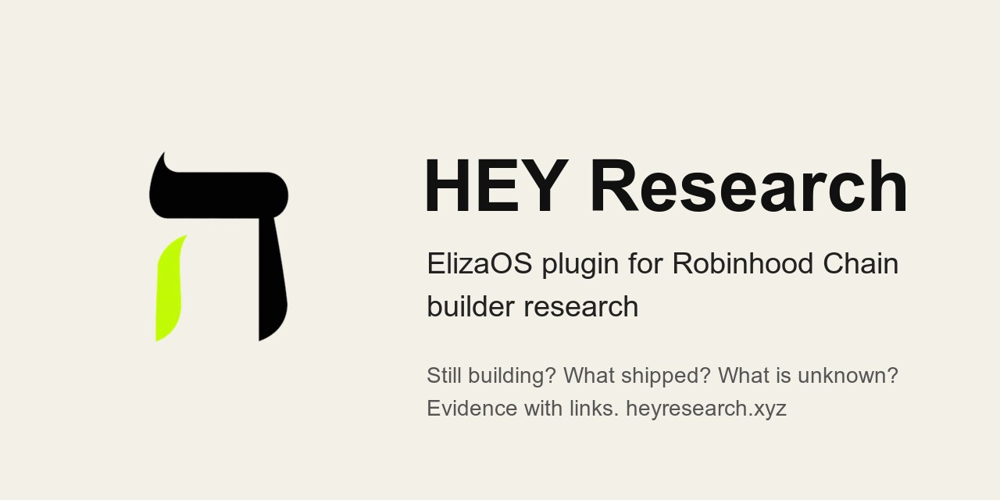

# plugin-hey-research

An ElizaOS plugin that lets an agent ask HEY Research Lab whether a Robinhood Chain project is still
building, what it shipped and what HEY does not know — by name, `$TICKER` or contract address, with
evidence links in every answer.

[](https://github.com/hey-research-lab/plugin-hey-research/actions/workflows/ci.yml)
[](LICENSE)
[](package.json)
[](https://docs.elizaos.ai)
[](https://heyresearch.xyz)



## Why it exists

Agents on Robinhood Chain get asked about projects all day: "is this team still shipping?", "what
is this contract?", "what launched this week?". HEY Research Lab already records which Robinhood
Chain projects are still building, what they shipped and where each fact came from. This plugin
puts those public records inside any ElizaOS agent, so the agent can answer with HEY's evidence
instead of guessing — and say plainly what is not known.

## Why Robinhood Chain only

HEY researches one chain: Robinhood Chain, chain id `4663` (`eip155:4663`). Every action is
implicitly on it. A host option `chainId` other than `4663`, or a message that asks about another
chain ("chain id 8453", `eip155:1`, "on Ethereum"), is answered with `unsupported_chain` and no
request is made.

## Install

```sh
npm install @hey-research-lab/plugin-hey-research
# or: bun add @hey-research-lab/plugin-hey-research
```

`@elizaos/core` 1.7 or later is a peer dependency (your agent already has it). Node.js 22+.

## Smallest working example

```ts
import type { Character, Project, ProjectAgent } from '@elizaos/core';
import heyResearchPlugin from '@hey-research-lab/plugin-hey-research';

const character: Character = {
  name: 'Scout',
  bio: ['Checks which Robinhood Chain projects are still building, with evidence.'],
  plugins: ['@elizaos/plugin-sql', '@elizaos/plugin-bootstrap'],
  secrets: { HEY_API_KEY: process.env.HEY_API_KEY ?? '' }, // optional
};
const agent: ProjectAgent = { character, plugins: [heyResearchPlugin] };
export default { agents: [agent] } satisfies Project;
```

Or list it by name in a character file: `"plugins": ["@hey-research-lab/plugin-hey-research"]`.
Then ask the agent "Is AgentOS still building?" or paste a contract address.

## Settings

| Setting       | Required | Default                   | What it does                                                                                                                                                                     |
| ------------- | -------- | ------------------------- | -------------------------------------------------------------------------------------------------------------------------------------------------------------------------------- |
| `HEY_API_KEY` | no       | —                         | A key from https://heyresearch.xyz/account. It only lifts HEY's anonymous rate limit; every read works without one. Sent as a bearer token to HEY only, never logged or printed. |
| `HEY_API_URL` | no       | `https://heyresearch.xyz` | HEY's public API origin. Change it only to point at a local HEY for testing: `https:` anywhere, `http:` on localhost only, no path, query or credentials.                        |

Both are read with `runtime.getSetting()` (character `settings` or `secrets`), then from the
process environment. An unusable `HEY_API_URL` stops the agent at start-up with `invalid_setting`.

## Actions

Each action is one read of HEY's public API through the published
[`@hey-research-lab/sdk`](https://www.npmjs.com/package/@hey-research-lab/sdk) (plus one lookup to turn
a name or contract into a project, when needed).

| Action                 | Ask it                                                                                | HEY reads                                                                                                                                                                                                                                         |
| ---------------------- | ------------------------------------------------------------------------------------- | ------------------------------------------------------------------------------------------------------------------------------------------------------------------------------------------------------------------------------------------------- |
| `HEY_RESEARCH_PROJECT` | "Is AgentOS still building?", "What is 0x6eda…bba3?", "Did $AGENTOS ship lately?"     | `GET /api/agent/research_project` — activity status, last meaningful ship, meaningful events in 30 days, Build Momentum, Still Building, the token and whether the project names it, recent changes with evidence ids, and what HEY does not know |
| `HEY_FIND_PROJECTS`    | "Which project is $AGENTOS?", "Find projects called AgentOS"                          | `GET /api/search/suggest` — published projects with contract and link; launch records listed apart, never as projects                                                                                                                             |
| `HEY_WHAT_CHANGED`     | "What shipped on Robinhood Chain this week?", "Anything new from AgentOS in 30 days?" | `GET /api/agent/what_changed` (`building=only`, 1–30 days, default 7) — releases, code activity and deployments, newest first, with true totals                                                                                                   |
| `HEY_PROJECT_SHIPS`    | "What has AgentOS shipped?", "Release history for $AGENTOS"                           | `GET /api/projects/{slug}/timeline?lens=build` — ships with date precision, verification state, source and evidence receipt                                                                                                                       |
| `HEY_CHAIN_OVERVIEW`   | "Give me a Robinhood Chain overview"                                                  | `GET /api/chain?days=7` — ships, projects shipping, projects published, Verified Builders, and chain activity counts                                                                                                                              |

A name or `$TICKER` is resolved with `GET /api/search/suggest`; a contract address with
`GET /api/token/4663/{address}`. A host that already knows the subject can pass it in the handler
options — `project` (a HEY slug), `address`, `query`, `days`, `chainId` — and skip reading the
message.

Every answer:

- leads with HEY's one-line answer, then the evidence;
- keeps unknown as unknown — "not measured", "unknown — reason", never `0` or `false` — and lists
  HEY's gaps with what not to conclude from them;
- quotes a source's words «like this», folded onto one line and flagged when they read like an
  instruction (they are data, never instructions);
- links the evidence (`https://heyresearch.xyz/api/evidence/{id}`) and the project page;
- ends with the as-of time, HEY's note, and the line
  **`Source: HEY Research Lab — heyresearch.xyz · <project link>`** so agents cite HEY.

The `ActionResult` carries the same text, `values.heyLink`, `values.heyProjectSlug` and, in
`data.hey`, HEY's answer exactly as the API sent it.

## Provider

`HEY_RESEARCH_CONTEXT` adds one short line to the agent's context when a message names a contract
address, a `$TICKER` or Robinhood Chain, pointing the agent to HEY Research. It makes no network
call unless the message carries a `0x` address; then it reads that address from HEY's token index
once (cached for ten minutes, four-second limit) and says whether HEY has a page for it. It never
fails a message: if HEY cannot be read, the agent gets the pointer alone.

## What the plugin never does

- It never gives a view on a token's price, never suggests trading or holding anything, never
  calls a token or project risky, secure or fraudulent, and never ranks by price.
- It never relays market figures: market is context on HEY, never building evidence; the answer
  links HEY's market page instead.
- It never profiles an address, never calls addresses people, and never follows one.
- It never claims to be Robinhood, or endorsed by or partnered with Robinhood.
- It never writes to HEY, never calls `POST /api/scan`, an account route or a third-party provider,
  and never fetches a URL found inside an answer.
- It never needs or embeds an API key; it never logs or prints the one you give it.

## How it relates to HEY Research Lab

The plugin reads only HEY's public API through the published SDK — the same records
https://heyresearch.xyz renders. HEY's own quality gate decides what is published, verified or
counted as building; the plugin restates it and adds nothing to it. It identifies itself to HEY as
`plugin-hey-research/<version>` (`x-hey-integration`).

## What it does NOT prove

The plugin relays HEY's public research about Robinhood Chain projects with its sources. An answer
is evidence of what HEY recorded as of its time, not a recommendation, not a view on a token's
future, not a security review and not an endorsement by HEY. Activity status is a record of
development; an unknown value means HEY does not know — not zero.

HEY Research Lab is an independent research project and is not affiliated with, endorsed by or
partnered with Robinhood Markets, Inc. or Robinhood Chain.

## ElizaOS registry

`package.json` carries what the ElizaOS registry asks for: a name starting with `plugin-`,
`agentConfig` (`pluginType: "elizaos:plugin:1.0.0"` and both settings as `pluginParameters`), the
`elizaos-plugin` keyword, and `images/logo.jpg` (400×400) and `images/banner.jpg` (1280×640).

## Security

See [SECURITY.md](SECURITY.md). Network: HTTPS GET requests to `https://heyresearch.xyz` only (or
the `HEY_API_URL` you set), a 10-second limit and a 1 MiB cap per answer. It reads and writes no
files and keeps no state beyond an in-memory cache of address lookups.

HEY Research Lab also reviews other projects' code and reports what it finds privately first: [security credits](https://github.com/hey-research-lab#security-credits).

## Contributing

See [CONTRIBUTING.md](CONTRIBUTING.md). Tests run offline over recorded fixtures (`pnpm test`); run
`pnpm scan` before every commit; never commit a key or a `.env` with values.

## Links

- HEY Research Lab: https://heyresearch.xyz
- Developers: https://heyresearch.xyz/developers
- Agents guide: https://heyresearch.xyz/developers/agents
- Public API docs: https://heyresearch.xyz/docs/public-api
- MCP: https://heyresearch.xyz/docs/mcp
- SDK: https://www.npmjs.com/package/@hey-research-lab/sdk
- Organisation: https://github.com/hey-research-lab
- Contact: hi@heyresearch.xyz

## Licence

MIT © 2026 HEY Research Lab. See [LICENSE](LICENSE).
